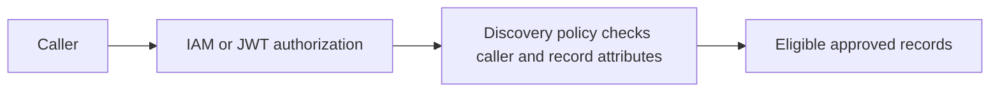

# Entitlement-based discovery in AWS Agent Registry

This sample creates two registries and verifies what callers can discover. The IAM example uses role tags to distinguish production and development and shows how approval changes discovery. The JWT example uses Cognito access token claims to distinguish HR callers.



## Prerequisites

Use Python 3.11 or later, AWS CLI profiles for a publisher and curator, and a region and AWS account that support entitlement-based discovery. The publisher needs permissions to create and delete a registry and its records and to manage its discovery policy. The curator needs permission to approve record revisions. For the optional role setup, the publisher also needs IAM role management permissions.

Install dependencies in a local virtual environment. Use a public boto3 release whose Agent Registry control-plane client supports discovery policies and custom metadata. The dependency pin must be updated to that release before publication.

```bash
python -m venv .venv
source .venv/bin/activate
python -m pip install -r requirements.txt
```

## Walkthrough

```bash
export AWS_REGION=ap-southeast-2
python blog_sample.py --state platform.json setup --scenario iam \
  --name PlatformTools --owner-profile publisher --curator-profile curator
python blog_sample.py --state platform.json verify --caller prod --profile prod-agent
python blog_sample.py --state platform.json verify --caller dev --profile dev-agent
python blog_sample.py --state platform.json verify --caller untagged --profile untagged-agent
python blog_sample.py --state platform.json promote \
  --owner-profile publisher --curator-profile curator
python blog_sample.py --state platform.json verify --caller prod --profile prod-agent
```

Configure the three discovery-only IAM profiles to assume roles tagged
`environment=prod`, `environment=dev`, or with no environment tag. Grant
`agent-registry:ListDiscoverableRegistryRecords` and
`agent-registry:SearchDiscoverableRegistryRecords` on the registry ARN and
`agent-registry:GetDiscoverableRegistryRecord` on its record ARNs. The curator
needs permission to approve record versions. Production discovers the preview
record only after promotion and approval. Neither role discovers the export
record while it is under review.

For JWT, configure the Cognito pool and app clients before creating the registry.
Use client credentials and a pre token generation trigger to issue these access
claims. An existing compatible OIDC provider also works.

| Caller | `data_access` | `compliance` | `sensitivity` |
| --- | --- | --- | --- |
| `finance` | `["financial", "engineering"]` | `["SOX"]` | `high` |
| `engineering` | `["engineering"]` | omitted | `medium` |
| `hr-case` | `["PII"]` | `["HIPAA"]` | `medium` |
| `hr-audit` | `["PII"]` | `["SOX", "HIPAA"]` | `medium` |

```bash
python blog_sample.py --state business.json setup --scenario jwt \
  --name BusinessTools --owner-profile publisher --curator-profile curator \
  --discovery-url "$OIDC_DISCOVERY_URL" --allowed-client "$HR_CASE_CLIENT_ID" \
  --allowed-client "$HR_AUDIT_CLIENT_ID" --allowed-client "$FINANCE_CLIENT_ID" \
  --allowed-client "$ENGINEERING_CLIENT_ID"
# Set EBD_ACCESS_TOKEN securely to the access token for the caller you test.
python blog_sample.py --state business.json verify --caller hr-case
# Replace EBD_ACCESS_TOKEN with the HR audit token before this command.
python blog_sample.py --state business.json verify --caller hr-audit
unset EBD_ACCESS_TOKEN
```

Verification waits for the exact List and BatchGet catalogs, checks that hidden
IDs return `RESOURCE_NOT_FOUND`, and ensures semantic search returns only
entitled records. The HR audit view adds the benefits/payroll sync entry. Both
HR callers are limited to medium sensitivity, so neither sees payroll processing.

Run `python blog_sample.py --state <file> cleanup --owner-profile publisher`
for each scenario. It deletes only the records and registry saved in that state
file. Remove any IAM roles and identity-provider resources you created for the
example separately.

To use the supplied Cognito trigger, deploy `cognito_claims.py` as a Python
Lambda function with handler `cognito_claims.lambda_handler`. In a Cognito
user pool that supports machine identities, create a resource server with a
sample discovery scope and four confidential app clients, each with that scope
and the client credentials flow enabled. Set the Lambda environment variable
`EBD_CLIENT_CALLERS` to a JSON object mapping the four app client IDs to
`finance`, `engineering`, `hr-case`, and `hr-audit`. Add the function as a V3_0
pre token generation trigger and grant the user pool permission to invoke it.
The trigger assigns claims from the app client ID authenticated by Cognito.
Configure a user pool domain and request each token from its `/oauth2/token`
endpoint using the app client's credentials and the discovery scope.

To create the three IAM roles instead of supplying existing roles, run
`python blog_sample.py --state platform.json create-roles --owner-profile publisher --prefix <unique-prefix> --trusted-arn <source-iam-role-or-user-arn>`.
The command prints the role ARNs. Configure each named discovery profile with
its `role_arn` and a `source_profile` that can assume it. Cleanup removes roles
created by this command and saved in the state file.
